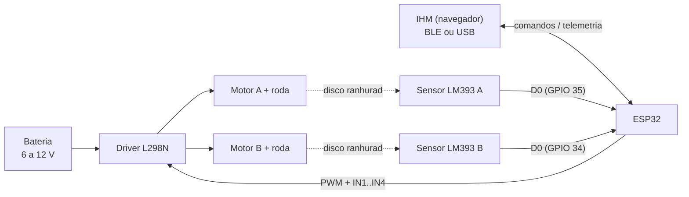

# Robô móvel 2WD: componentes e ligações

Robô móvel de duas rodas com controle de **posição por odometria**, desenvolvido para a 2ª Avaliação de Robótica. Este documento descreve cada componente de hardware, para que ele serve e como é ligado ao ESP32.

> **Imagens:** os arquivos referenciados abaixo devem ficar na pasta `docs/imagens/` do repositório (nomes sugeridos em cada seção).

## Sumário

1. [Visão geral](#1-visão-geral)
2. [Lista de componentes](#2-lista-de-componentes)
3. [ESP32 (microcontrolador)](#3-esp32-microcontrolador)
4. [Driver de motores L298N](#4-driver-de-motores-l298n)
5. [Motores DC com caixa de redução e rodas](#5-motores-dc-com-caixa-de-redução-e-rodas)
6. [Encoder: disco ranhurado + sensor LM393](#6-encoder-disco-ranhurado--sensor-lm393)
7. [Tabela geral de ligações](#7-tabela-geral-de-ligações)
8. [Alimentação e terra comum](#8-alimentação-e-terra-comum)
9. [Como o software usa o hardware](#9-como-o-software-usa-o-hardware)
10. [Checklist de montagem e solução de problemas](#10-checklist-de-montagem-e-solução-de-problemas)

---

## 1. Visão geral

O ESP32 lê os dois encoders (um por roda), calcula a rotação (RPM) e a distância percorrida (odometria) e comanda o driver L298N, que aciona os dois motores. O usuário controla tudo por uma IHM web, via **Bluetooth LE** ou **USB (Serial)**.

Malhas de controle (implementadas no firmware):

- **Malha interna:** PID de rotação de cada roda (RPM).
- **Malha externa:** controlador de posição (P, I, D, PI, PD, PID) cuja saída é a velocidade comandada às rodas.

---

## 2. Lista de componentes

| Qtd | Componente | Função |
|----|------------|--------|
| 1 | ESP32 DevKit | Processamento, PWM, leitura dos encoders, Bluetooth LE |
| 1 | Driver de motores L298N (ponte H dupla) | Aciona os dois motores (sentido e potência) |
| 2 | Motor DC amarelo com caixa de redução (tipo TT) | Tração |
| 2 | Roda de borracha (≈ 65 mm de diâmetro) | Contato com o piso |
| 2 | Disco encoder ranhurado (20 furos) | Gera os pulsos de posição/velocidade |
| 2 | Módulo sensor de velocidade LM393 (ranhura óptica) | Lê os furos do disco |
| 1 | Bateria / fonte (6 a 12 V) | Alimenta motores e driver |
| - | Chassi 2WD, roda boba, jumpers | Estrutura |

---

## 3. ESP32 (microcontrolador)

*Sugestão de nome: `docs/imagens/esp32_devkit.png`*

O ESP32 é o "cérebro" do robô:

- Gera **PWM** (periférico LEDC, 10 bits, 1 kHz) para controlar a velocidade dos motores.
- Recebe os pulsos dos encoders por **interrupção externa** (borda de descida).
- Executa os PIDs a cada 100 ms.
- Fala com a IHM por **Bluetooth LE** (serviço Nordic UART, nome `Carrinho-ESP32`) ou **USB Serial a 115200 baud**.
- Guarda ganhos e parâmetros na flash (NVS).

Pinos usados:

| Função | GPIO | Observação |
|--------|------|------------|
| Motor A: PWM (ENA) | 25 | Canal LEDC 0 |
| Motor A: IN1 | 26 | Sentido |
| Motor A: IN2 | 27 | Sentido |
| Motor B: PWM (ENB) | 33 | Canal LEDC 2 |
| Motor B: IN3 | 32 | No firmware aparece como `IN1` do motor B |
| Motor B: IN4 | 13 | No firmware aparece como `IN2` do motor B |
| Encoder A (D0 do LM393) | 35 | Só entrada, sem pull-up interno |
| Encoder B (D0 do LM393) | 34 | Só entrada, sem pull-up interno |

> Os GPIO 34 e 35 são **somente entrada** e não têm pull-up interno. Isso não é problema: o módulo LM393 já tem resistor na saída D0.

---

## 4. Driver de motores L298N

| Pinagem e conectores | Visão 3D |
|---|---|
|  |  |

*Sugestão de nomes: `l298n_pinagem.png` e `l298n_3d.png`.*

O L298N é uma **ponte H dupla**: cada canal controla um motor DC, permitindo girar nos dois sentidos e variar a velocidade por PWM.

### Bornes e pinos (conforme a imagem de pinagem)

| Identificação na placa | O que é | Ligação neste robô |
|---|---|---|
| **MOTOR A** | Borne de saída do motor A | Fios do motor A |
| **MOTOR B** | Borne de saída do motor B | Fios do motor B |
| **6-35V** | Entrada de alimentação dos motores | Positivo da bateria |
| **GND** | Terra | Negativo da bateria **e** GND do ESP32 |
| **5V** | Saída de 5 V do regulador interno (com o jumper "ativa 5V" colocado) ou entrada de 5 V | Pode alimentar o ESP32 pelo pino 5V/VIN (opcional) |
| **ATIVA MA** (ENA) | Habilita o canal A. Vem com jumper | **Remover o jumper** e ligar ao GPIO 25 (PWM) |
| **ATIVA MB** (ENB) | Habilita o canal B. Vem com jumper | **Remover o jumper** e ligar ao GPIO 33 (PWM) |
| **ENTRADA** (IN1 a IN4) | Define o sentido de cada motor | IN1→GPIO 26, IN2→GPIO 27, IN3→GPIO 32, IN4→GPIO 13 |
| **ATIVA 5V** (jumper) | Liga o regulador de 5 V interno | Manter com bateria até 12 V; retirar acima disso |

### Como o firmware aciona o driver

| IN1 | IN2 | Resultado (motor A) |
|-----|-----|---------------------|
| 1 | 0 | Frente |
| 0 | 1 | Ré |
| 1 | 1 | **Freio ativo** (usado ao chegar na posição) |
| 0 | 0 | Solto (roda livre) |

A velocidade vem do **PWM no pino ENA/ENB**. Por isso o jumper de ENA/ENB precisa ser removido: com ele, o canal fica sempre a 100 % e o PWM não tem efeito.

> **Queda de tensão:** o L298N perde cerca de 1,4 a 2 V na ponte. Por isso o firmware limita o duty a 50 % por padrão (comando `L`) e usa duty mínimo de 10 % para vencer a zona morta do motor.

---

## 5. Motores DC com caixa de redução e rodas

| Motor + roda | Motor com caixa de redução |
|---|---|
|  |  |

*Sugestão de nomes: `motor_roda.png` e `motor_tt.png`.*

- Motor DC de escovas dentro de uma **caixa de redução amarela** (tipo TT). A redução aumenta o torque e reduz a rotação na roda.
- O eixo de saída da caixa de redução é duplo: de um lado vai a **roda**, do outro pode ser encaixado o **disco do encoder**.
- Ligação: dois fios do motor nos bornes **MOTOR A** / **MOTOR B** do L298N. Se uma roda girar ao contrário do esperado, inverta os dois fios do motor (ou use o comando `E`/`I` da IHM).
- Parâmetros no firmware: roda de **65 mm** de diâmetro (comando `A W` / `B W` para calibrar), circunferência ≈ 204,2 mm.

---

## 6. Encoder: disco ranhurado + sensor LM393

| Princípio de funcionamento | Discos ranhurados |
|---|---|
|  |  |

| Sensor LM393 (partes) | Sensor LM393 (vista real) |
|---|---|
|  |  |

*Sugestão de nomes: `encoder_principio.png`, `encoder_discos.png`, `lm393_pinagem.png`, `lm393_modulo.png`.*

### Como funciona

1. O **disco ranhurado** (20 furos) é fixado no eixo do motor/roda e gira junto.
2. O sensor tem uma "forquilha" com um **LED infravermelho** (emissor) de um lado e um **fototransistor** (receptor) do outro.
3. Quando um furo passa, o feixe chega ao receptor; quando a parte sólida passa, o feixe é cortado.
4. O comparador **LM393** transforma isso em um sinal digital limpo na saída **D0**.
5. O ESP32 conta esses pulsos por interrupção e calcula:
   - **RPM** = pulsos por segundo × 60 / 20
   - **Distância** = (pulsos / 20) × circunferência da roda

**Resolução da odometria:** 204,2 mm / 20 ≈ **10,2 mm por pulso**.

### Pinos do módulo LM393

| Pino | Função | Ligação |
|------|--------|---------|
| **VCC** | Alimentação (3,3 a 5 V) | **3V3 do ESP32** (mantém D0 em 3,3 V, seguro para o GPIO) |
| **GND** | Terra | GND do ESP32 |
| **D0** | Saída digital (usada) | Sensor A → **GPIO 35**; sensor B → **GPIO 34** |
| **A0** | Saída analógica | **Não usada** |

LEDs do módulo: **LED ON/OFF** indica que está energizado; **LED de detecção** muda de estado quando o feixe é interrompido (ótimo para testar à mão com um papel na ranhura).

### Limitação importante

O módulo **não detecta o sentido de giro** (é um encoder de um canal). O firmware assume o sentido comandado e só troca o sinal da contagem quando a roda quase parou (abaixo de 20 RPM). Assim a odometria desconta a ré corretamente.

---

## 7. Tabela geral de ligações

| De | Pino | Para | Pino |
|----|------|------|------|
| ESP32 | GPIO 25 | L298N | ENA (ATIVA MA, sem jumper) |
| ESP32 | GPIO 26 | L298N | IN1 |
| ESP32 | GPIO 27 | L298N | IN2 |
| ESP32 | GPIO 33 | L298N | ENB (ATIVA MB, sem jumper) |
| ESP32 | GPIO 32 | L298N | IN3 |
| ESP32 | GPIO 13 | L298N | IN4 |
| ESP32 | GND | L298N | GND |
| LM393 A | D0 | ESP32 | GPIO 35 |
| LM393 B | D0 | ESP32 | GPIO 34 |
| LM393 A e B | VCC | ESP32 | 3V3 |
| LM393 A e B | GND | ESP32 | GND |
| Motor A | 2 fios | L298N | Borne MOTOR A |
| Motor B | 2 fios | L298N | Borne MOTOR B |
| Bateria | + | L298N | 6-35V |
| Bateria | - | L298N | GND |

---

## 8. Alimentação e terra comum

- **Motores e driver:** bateria de 6 a 12 V no borne `6-35V` do L298N.
- **ESP32:** pelo cabo USB, ou pelo pino 5V/VIN a partir do borne `5V` do L298N (com o jumper "ativa 5V" colocado). **Não ligue USB e 5V externo ao mesmo tempo** sem proteção.
- **GND comum obrigatório:** bateria, L298N, ESP32 e sensores devem compartilhar o mesmo terra. Sem isso, os sinais de controle e os pulsos do encoder ficam instáveis.
- Se a bateria passar de 12 V, retire o jumper "ativa 5V" e alimente o ESP32 por outra via.

---

## 9. Como o software usa o hardware

| Parâmetro | Valor |
|-----------|-------|
| Frequência do PWM | 1 kHz, resolução de 10 bits |
| Pulsos por volta (PPR) | 20 |
| Diâmetro da roda | 65 mm |
| Período dos PIDs | 100 ms |
| Debounce do encoder | 300 µs |
| Duty mínimo / máximo | 10 % / 50 % (ajustável com `L`) |
| BLE | Nordic UART Service, nome `Carrinho-ESP32` |
| Serial | 115200 baud |

Arquivos do projeto:

- `firmware_robo_esp32.ino`: firmware (biblioteca QuickPID; core ESP32 2.x ou 3.x).
- `IHM - Análise de controle.html`: interface web (use Chrome ou Edge, que têm Web Bluetooth e Web Serial).

Os controles disponíveis são malha aberta (MA) e malha fechada com P, I, D, PI, PD e PID. Os comandos completos estão no cabeçalho do firmware.

---

## 10. Checklist de montagem e solução de problemas

- [ ] Jumpers ENA e ENB **removidos** do L298N.
- [ ] GND comum entre bateria, L298N, ESP32 e sensores.
- [ ] LM393 alimentado com 3V3 e com o disco passando dentro da ranhura, sem encostar.
- [ ] Discos bem fixos no eixo (um disco frouxo gera pulsos errados).

| Sintoma | Causa provável | Solução |
|---------|----------------|---------|
| Motor gira sempre na velocidade máxima | Jumper ENA/ENB ainda colocado | Remover o jumper |
| Motor não parte | Duty abaixo da zona morta ou bateria fraca | Aumentar o duty ou trocar a bateria |
| Roda gira ao contrário | Fios do motor invertidos | Trocar os fios ou usar `I` / `E` na IHM |
| RPM sempre zero | Sensor sem VCC, D0 em pino errado ou disco desalinhado | Conferir o LED de detecção do módulo |
| Robô desvia da reta | Rodas ou motores diferentes | Ajustar o PID "andar reto" (`H`) e conferir o diâmetro de cada roda |
| Erro de distância constante | Diâmetro ou PPR incorretos | Calibrar com `A W`, `B W`, `A P`, `B P` |
| "sem progresso (roda travada ou encoder sem sinal)" | Encoder não gera pulsos | Verificar a ligação de D0 e a alimentação do sensor |
